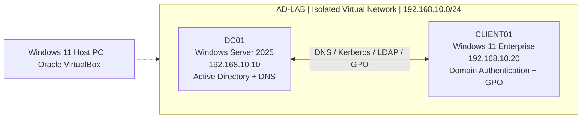

# Active Directory Home Lab — Windows Server Administration & Security Monitoring

A hands-on lab simulating a small company's Windows domain infrastructure, identity administration, workstation security policies, and authentication incident investigations. Built as an IT support / junior cybersecurity portfolio project using an isolated VirtualBox network.

> **Scope:** Personal training environment using fictional accounts and non-production systems. Screenshots document actual lab activity; they are not from an employer or production network.

## At a glance

| Component | Configuration |
|---|---|
| Hypervisor | Oracle VirtualBox |
| Domain controller | DC01 — Windows Server 2025 Evaluation |
| Client | CLIENT01 — Windows 11 Enterprise Evaluation |
| AD domain | `corp.adlab.test` (NetBIOS: `CORP`) |
| Domain controller IP | `192.168.10.10/24` |
| Client IP | `192.168.10.20/24` |
| DNS | DC01 (`192.168.10.10`) |
| Network | `AD-LAB` VirtualBox Internal Network (isolated) |
| Identity structure | 5 initial OUs under `AdLab-Technologies`, 8 sample users, 4 departmental global security groups |

## Architecture

The lab network deliberately does not require a default gateway or external connectivity for domain operations. CLIENT01 was joined to `corp.adlab.test` and is administered centrally using Active Directory.

## Implementation

1. **Windows Server deployment:** Installed and renamed DC01; configured static IPv4 networking; verified with `ipconfig /all` and `ping`. [Evidence](screenshots/01-DC01-server-configuration.png)
2. **Active Directory and DNS:** Promoted DC01 to a domain controller for `corp.adlab.test`. Verified basic DNS tests using `dcdiag /test:dns /DnsBasic /v` and domain controller discovery with `nltest /dsgetdc:corp.adlab.test`. [Evidence](screenshots/02-active-directory-domain-structure.png)
3. **Identity administration:** Created `AdLab-Technologies` with IT, HR, Finance, Sales and Groups OUs; provisioned 8 fictional users; created `GG_IT_Users`, `GG_HR_Users`, `GG_Finance_Users` and `GG_Sales_Users`; populated memberships. [OU evidence](screenshots/03-organisational-unit-structure.png) · [User evidence](screenshots/04-active-directory-user-accounts.png) · [Group evidence](screenshots/05-security-group-membership.png)
4. **Client deployment:** Installed CLIENT01, assigned DNS to DC01 and joined the domain; signed in with `CORP\jwilson`. [Computer evidence](screenshots/06-domain-joined-workstation.png) · [Authentication evidence](screenshots/07-domain-user-authentication.png)
5. **Group Policy:** Created `Workstations` OU, linked `GPO-Workstation-Security`, and configured machine inactivity limit to **300 seconds**. Policy application and workstation lock were verified during the lab. [GPO evidence](screenshots/08-group-policy-configuration.png)
6. **Security investigations:** Analysed failed interactive logon, user-account disablement and domain-account lockout events, then restored test accounts. See the reports below.

## Security investigations

| Investigation | Evidence | Report |
|---|---|---|
| Failed domain login (`4625`) | `CORP\jwilson`; logon type 2; substatus `0xC000006A` | [Incident 001](docs/incidents/incident-001-failed-logon.md) |
| Account disabled (`4725`) | `CORP\nanderson` targeted by `CORP\Administrator` | [Incident 002](docs/incidents/incident-002-account-disabled.md) |
| Account locked (`4740`) | `lockouttest`; event on DC01 with `CLIENT01` in event data | [Incident 003](docs/incidents/incident-003-account-lockout.md) |

## Screenshot index

| # | Evidence |
|---|---|
| 01 | [DC01 server IP / DNS configuration](screenshots/01-DC01-server-configuration.png) |
| 02 | [Active Directory domain and DC01](screenshots/02-active-directory-domain-structure.png) |
| 03 | [Organisational unit structure](screenshots/03-organisational-unit-structure.png) |
| 04 | [IT user accounts](screenshots/04-active-directory-user-accounts.png) |
| 05 | [Global security group membership](screenshots/05-security-group-membership.png) |
| 06 | [CLIENT01 computer account](screenshots/06-domain-joined-workstation.png) |
| 07 | [Domain-user `whoami` and `hostname`](screenshots/07-domain-user-authentication.png) |
| 08 | [Inactivity-limit GPO](screenshots/08-group-policy-configuration.png) |
| 09 | [Failed login event 4625](screenshots/09-failed-login-investigation.png) |
| 10 | [Account disable event 4725](screenshots/10-account-management-audit.png) |
| 11 | [Account lockout event 4740](screenshots/11-account-lockout-investigation.png) |

## Tools and skills

**Tools:** Windows Server 2025, Active Directory Domain Services, DNS Manager, Active Directory Users and Computers, Group Policy Management, Event Viewer, PowerShell, Command Prompt, Oracle VirtualBox.

**Practised:** VM provisioning; Windows domain deployment; static IP and DNS configuration; organisational units; account provisioning; security group administration; workstation domain joining; Group Policy; account lifecycle tasks; Windows Security Event interpretation; incident documentation.

## Verification and limitations

- Basic `dcdiag` DNS tests and `nltest` domain controller discovery passed. Early `nslookup` commands occasionally showed timeouts before returning successful records; this is documented as an observed transient behaviour, not presented as proven fully resolved.
- Lab authentication/audit events are intentionally generated; they do **not** establish a real intrusion or attacker identity.
- An AD group membership alone does not grant file access. No shared-folder ACL implementation is claimed.
- The Group Policy screenshot demonstrates configured settings; policy application/lock operation were verified separately in the exercise.
- CLIENT01 displayed an expired Windows evaluation watermark during setup. If reusing this lab, check evaluation and licensing status; do not use it as a production deployment.
- This repo intentionally excludes VM disk images, passwords, credentials, account secrets, and any real organisational data.

Additional detail: [Lab build notes](docs/lab-notes.md) · [Architecture diagram source](diagrams/architecture.mmd).
